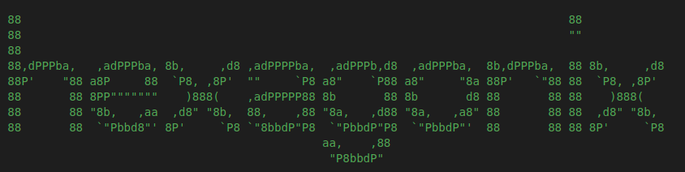

<!-- Vai funcionar como 
 -->

<table align="center">
<tr>
<td><a href="https://github.com/hexagonix/Doc/blob/main/Hexagonix/Hexagonix.pt.md#componentes-do-sistema">Componentes</a></td>
<td><a href="https://github.com/hexagonix/Doc/blob/main/Hexagonix/Hexagonix.pt.md#bibliotecas-de-desenvolvimento-do-sistema">Bibliotecas</a></td>
<td><a href="https://github.com/hexagonix/Doc/blob/main/Hexagonix/Hexagonix.pt.md#-capturas-de-tela">Screenshots</a></td>
<td><a href="https://github.com/hexagonix/Doc/blob/main/Hexagonix/Hexagonix.pt.md#contribuir-e-reportar-erros">Contribuir</a></td>
<td><a href="https://github.com/hexagonix/Doc/blob/main/Hexagonix/Hexagonix.pt.md#outras-informa%C3%A7%C3%B5es">Outras informações</a></td>
<td><a href="https://github.com/hexagonix/src">Código-fonte</a></td>
<td><a href="https://github.com/hexagonix/Doc/blob/main/Hexagonix/README.pt.md">Download</a></td>
</tr>
</table>

# A libasm

A `libasm` (bibliotecas para desenvolvimento de utilitários em Assembly x86) é um pacote de bibliotecas que auxiliam no processo de criação de utilitários para o Hexagonix, fornecendo definições, interfaces, constantes e macros úteis no processo de desenvolvimento e teste de um aplicativo.

Abaixo, uma lista com cada biblioteca dentro do pacote da libasm:

| Biblioteca | Funções |
|:----------:|:-------:|
|[`console.s`](https://github.com/hexagonix/lib/blob/main/fasm/console.s)| Funções para manipulação do console (físico e virtual), escritas como sequências de escape no descritor 1, e por isso também funcionam em um pseudoterminal: entre elas `gotoxy`, `gotoColumn`, `saveCursor`, `restoreCursor`, `clearConsoleLine`, `setConsoleColor`, `setConsoleForeground`, `resetConsoleColor`, `reverseConsoleColor` e `putCharacter`|
|[`dev.s`](https://github.com/hexagonix/lib/blob/main/fasm/dev.s)| Constantes para acessar os dispositivos reconhecidos pelo Hexagon|
|[`errors.s`](https://github.com/hexagonix/lib/blob/main/fasm/errors.s)| Definição de erros em resposta a chamadas de sistema do Hexagon|
|[`HAPP.s`](https://github.com/hexagonix/lib/blob/main/fasm/HAPP.s)| Macro para a criação de um cabaçalho HAPP para imagens executáveis|
|[`hexagon.s`](https://github.com/hexagonix/lib/blob/main/fasm/hexagon.s)| Definições para realizar chamadas de sistema ao Hexagon, e as macros `hx.setNonBlocking` e `hx.setCloseOnSpawn` para as marcas de um descritor|
|[`hexagonix.s`](https://github.com/hexagonix/lib/blob/main/fasm/hexagonix.s)| Macros e dados comuns aos componentes do Hexagonix|
|[`log.s`](https://github.com/hexagonix/lib/blob/main/fasm/log.s)| Macro para envio de mensagens pelo Hexagon|
|[`macros.s`](https://github.com/hexagonix/lib/blob/main/fasm/macros.s)| Macros avançados para facilitar o desenvolvimento de utilitários|
|[`memory.s`](https://github.com/hexagonix/lib/blob/main/fasm/memory.s)| Macros para manipulação de valores de memória|
|[`passwdHash.s`](https://github.com/hexagonix/lib/blob/main/fasm/passwdHash.s)| Hash de senhas e consulta ao `/shadow`, compartilhados por login, su, adduser, passwd e deluser|
|[`term.s`](https://github.com/hexagonix/lib/blob/main/fasm/term.s)| Um terminal guardado na memória como uma grade de células, para um programa que faz o papel de um: `termInit`, `termWrite`, que interpreta os bytes como o terminal do console do Hexagon, `termResize` e `termFree`|
|[`tty.s`](https://github.com/hexagonix/lib/blob/main/fasm/tty.s)| O terminal do processo: leitura e definição do seu modo, o tamanho da sua janela com `ttyGetSize`, a `readKey`, que espera uma única tecla, e a `readLine`, que edita uma linha sobre o modo cru e avisa o fim da entrada com CF definido|
|[`verUtils.s`](https://github.com/hexagonix/lib/blob/main/fasm/verUtils.s)| Funções para obter e processar informações de versão do Hexagonix|

Além disso, existe uma biblioteca específica, chamada `Estelar`. Essa biblioteca é dividida em dois componentes, [`Estelar`](https://github.com/hexagonix/lib/blob/main/fasm/Estelar/estelar.s) e [`Bigbang`](https://github.com/hexagonix/lib/blob/main/fasm/Estelar/bigbang.s). Essa biblioteca tem como objetivo facilitar o desenvolvimento de utilitários gráficos e que utilizem saída de som.

> As bibliotecas são desenvolvidas com foco no flat assembler (fasm). Verifique o diretório `fasm` para encontrar as bibliotecas, e `samples` para exemplos de aplicativos que as utilizam.

